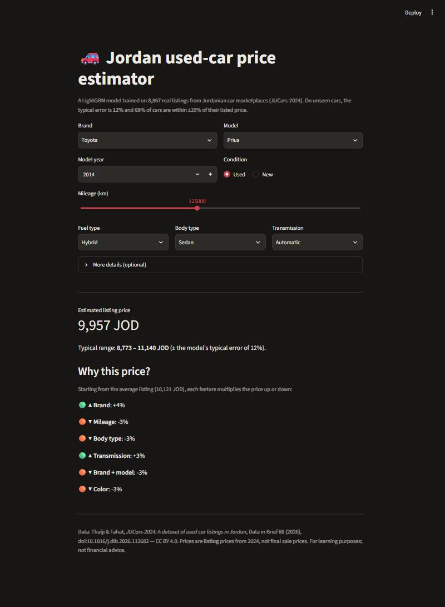
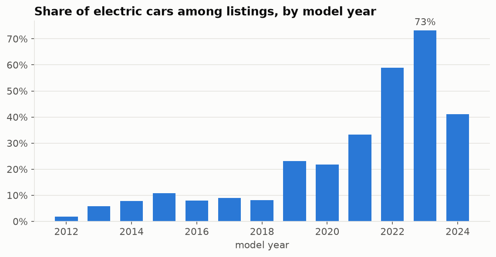
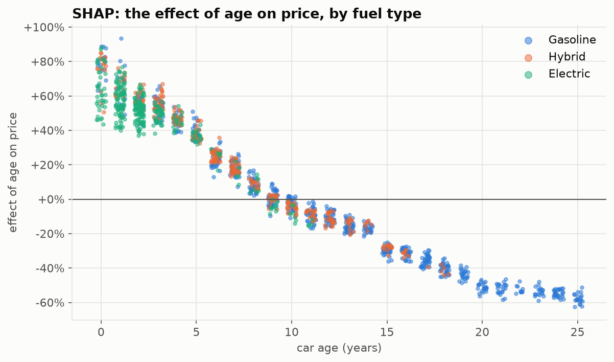
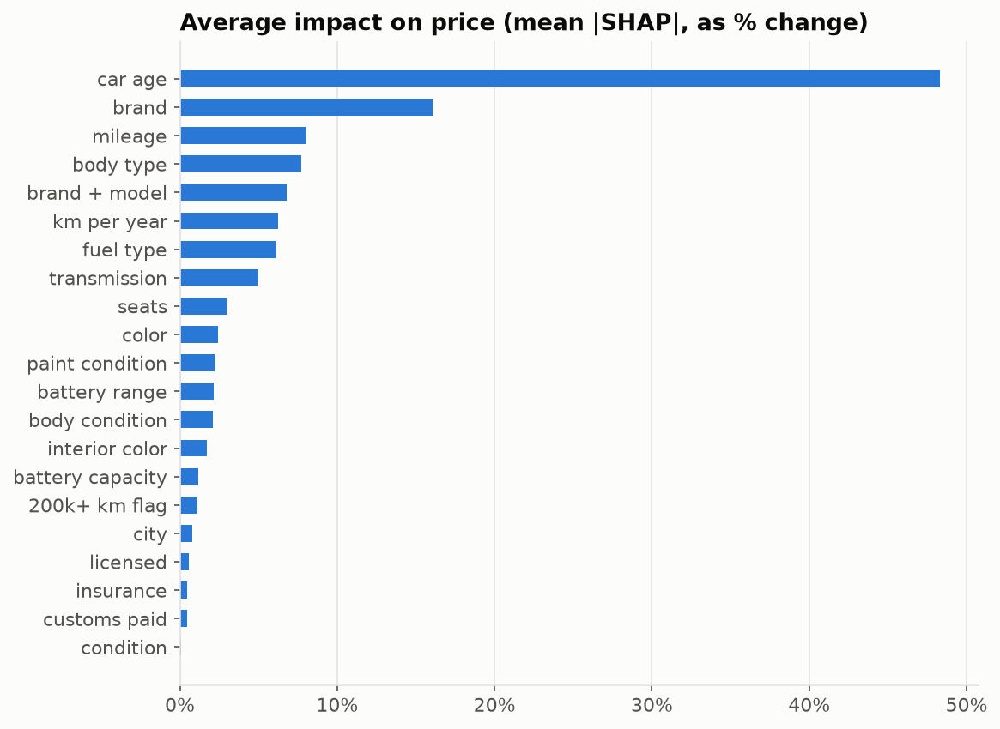

# 🚗 Jordan Used-Car Price Prediction

**How much is a used car worth in Jordan?** This project predicts a car's listing price (JOD) from its specs,
using **8,867 real listings** collected in 2024 from Jordan's main car marketplaces — and explains *why* each price
is what it is.

| Typical error on unseen cars | Within ±20% of price | MAE | R² (log price) |
|:---:|:---:|:---:|:---:|
| **11.9%** | **69%** | **2,974 JOD** | **0.79** |

<p align="center"></p>

---

## Highlights

- **Real, local, messy data** — not a toy dataset: placeholder prices (7,000,000 JOD for a 2011 Pajero), "call me"
  prices, duplicates, and a hidden meaning behind missing values.
- **A detective story in the data:** missing `mileage_km` wasn't random — it always meant **200,000+ km**.
  Naive median imputation would have told the model 1,706 cars had driven half their real distance.
- **When strong models couldn't beat a linear one, I asked why:** ~4% of listings carry fake prices (label noise).
  A **robust (Huber) loss** fixed it: median error 16.1% → 12.8% in cross-validation.
- **No leakage, honest evaluation:** split first, all learned preprocessing inside a scikit-learn `Pipeline`,
  tuning with 5-fold CV on the training set only, and the test set opened **once**. Noisy rows were *not* removed from the test set.
- **Explainable:** SHAP shows how each feature moves the price — and confirms the model learned real market effects.
- **Tested:** 53 `pytest` tests, written test-first (TDD), cover cleaning rules, features, metrics, training and prediction.

## What the model learned about the Jordanian market

| | |
|---|---|
|  | **The EV wave.** Among cars from model year 2023, **73% of listings are electric** — a direct effect of Jordan's lower customs on EVs. |
|  | **Depreciation, learned by itself.** Age is the #1 driver. Young **electric cars get a smaller "new" premium** than petrol and hybrid ones — an *age × fuel* interaction a linear model can't capture. |
|  | **What matters.** Age ≫ brand > mileage, body type, model, km/year, fuel. The **city barely matters** once the car is known: Zarqa's higher prices in the raw data come from *which* cars are sold there (free zone), not the city itself. |

## Results

Cross-validated on the training set (7,093 cars), then a single evaluation on the held-out test set (1,774 cars):

| Model | Median % error (CV) | Within ±20% (CV) | MAE (CV) |
|---|---:|---:|---:|
| Dummy (always the median) | — | — | 8,441 JOD |
| Ridge regression (baseline) | 15.0% | 62% | 3,463 JOD |
| LightGBM, squared error | 16.1% | 60% | 3,532 JOD |
| LightGBM, L1 loss | 13.2% | 66% | 3,251 JOD |
| XGBoost, L1 loss | 12.9% | 67% | 3,118 JOD |
| **LightGBM, Huber loss, tuned with Optuna** | **12.8%** | **67%** | **3,087 JOD** |
| ↳ **same model on the test set** | **11.9%** | **69%** | **2,974 JOD** |

Test ≈ CV, so the model generalizes rather than memorizes.

## Workflow

```
raw CSV ─► EDA ─► cleaning rules ─► feature engineering ─► train/test split (80/20, stratified)
        ─► baselines ─► tree models + robust loss ─► Optuna tuning (5-fold CV) ─► one test evaluation
        ─► SHAP explanations ─► predict() + Streamlit app
```

| Notebook | What it covers |
|---|---|
| [`01_eda.ipynb`](notebooks/01_eda.ipynb) | data quality, the price distribution, brand / age / fuel / city effects |
| [`02_baseline.ipynb`](notebooks/02_baseline.ipynb) | dummy + linear baselines, metrics explained, where linear models fail |
| [`03_models.ipynb`](notebooks/03_models.ipynb) | tree models, the label-noise investigation, robust losses, Optuna |
| [`04_explain.ipynb`](notebooks/04_explain.ipynb) | SHAP: global importance, the age effect, one car explained, reliability by segment |

## Project structure

```
jordan-car-prices/
├── app.py                  # Streamlit demo
├── data/raw/               # original JUCars-2024 files (never edited)
├── notebooks/              # the analysis story (01 → 04)
├── src/jocars/
│   ├── cleaning.py         # which listings to trust
│   ├── features.py         # engineered features + leakage-safe preprocessing
│   ├── models.py           # model factory (every model is a Pipeline)
│   ├── evaluate.py         # metrics in JOD and %, cross-validation
│   ├── train.py            # final fit + single test evaluation
│   └── predict.py          # predict_price() and explain_price()
├── tests/                  # 53 pytest tests
├── models/                 # trained model + tuned hyperparameters
├── reports/                # metrics and figures
└── docs/LEARN_AR.md        # step-by-step learning guide (Arabic)
```

## Run it

```bash
git clone https://github.com/Mohdsuhail06/jordan-car-prices.git
cd jordan-car-prices
python -m venv .venv
.venv\Scripts\activate          # Windows  (macOS/Linux: source .venv/bin/activate)
pip install -r requirements.txt
pip install -e .

pytest                          # 53 tests
python -m jocars.train          # retrain + evaluate on the test set
streamlit run app.py            # open the app at http://localhost:8501
```

Predict from Python:

```python
from jocars.predict import predict_price, explain_price

car = {"make": "Toyota", "model": "Camry", "year": "2019", "mileage_km": 84999,
       "fuel_type": "Hybrid", "body_type": "Sedan", "condition": "Used",
       "transmission": "Automatic", "city": "Amman"}
predict_price(car)      # -> price in JOD
explain_price(car)      # -> base price + each feature's contribution
```

## Limitations

- Prices are **asking prices** in listings (2024), not final sale prices.
- Some label noise remains (fake/"call me" prices); it limits mean-based metrics, which is why median error is reported too.
- Rare brands/models and luxury cars (40k+ JOD) have fewer examples and larger errors.
- The model reflects the 2024 market; prices drift (customs rules, new EV models), so it would need retraining over time.

## Data & credits

Dataset: **JUCars-2024: A dataset of used car listings in Jordan** — N. Thalji & K. Tahat,
*Data in Brief* 66 (2026), [doi:10.1016/j.dib.2026.112682](https://doi.org/10.1016/j.dib.2026.112682).
Data on [Mendeley Data](https://data.mendeley.com/datasets/ddcz486x5t), licensed **CC BY 4.0**.
Listings from OpenSooq, Dubizzle, Motory, AutoBeeb and Dooz.

Code: MIT license (see [LICENSE](LICENSE)). The dataset keeps its own CC BY 4.0 license.
